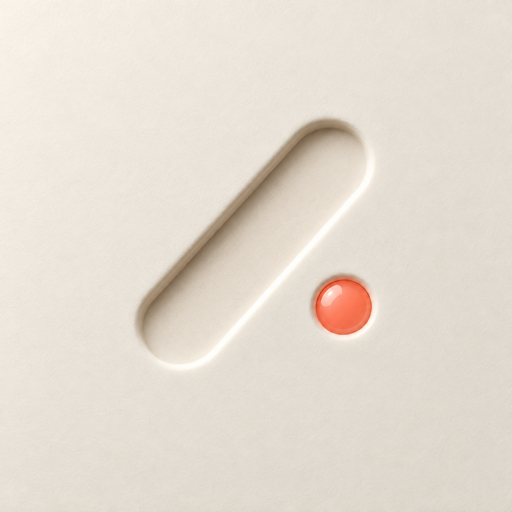

<p align="center"></p>
<h1 align="center">Baton</h1>
<p align="center">Run AI chats in parallel. Baton lives in your Mac's notch and pings you the moment one finishes or needs you.</p>
<p align="center"><a href="https://github.com/jeanlucandre-afk/baton/releases/latest/download/Baton.dmg"><b>Download for Mac</b></a> · macOS 26 or later · <a href="docs/INSTALL.md">Install guide</a></p>

---

- **Pings from the notch.** When a chat in ChatGPT, Codex, Claude, Cursor and others finishes or needs an
  answer, the notch pops open and says which one.
- **Every chat at a glance.** Hover the notch: what's working, what's ready, what needs you.
- **Jump straight there.** ⌥Tab goes to the next ready chat, ⌥N starts a new task.
- **Two looks.** Dark (melts into the notch) or Transparent (Liquid Glass). Screens without a notch get a
  virtual one.

## Install
Download **Baton.dmg** from [Releases](https://github.com/jeanlucandre-afk/baton/releases), drag Baton to
Applications and open it. Builds aren't notarized by Apple yet, so the first open needs
**System Settings › Privacy & Security › Open Anyway** once. Details and troubleshooting:
[docs/INSTALL.md](docs/INSTALL.md).

The welcome window then walks through Accessibility, notifications and keys:

| Key | What it does | Where |
| --- | --- | --- |
| **Jev** | Tells when a reply is finished or needs you. Without it Baton lists your chats but can't tell when one is done. | [typesafe.ai](https://typesafe.ai) |
| **Gemini** (optional) | Writes the one-line pings, task names and steps, and repairs reading after an app update. Without it Apple's on-device model writes them. | [aistudio.google.com/apikey](https://aistudio.google.com/apikey) |

Keys live in your login Keychain and can be changed any time in **Settings › Keys**.

## How it works
- **Reading:** Accessibility reads the chat list in each AI app's window, on your Mac. Local rules only
  ever say "working"; [Jev](https://typesafe.ai) decides finished / needs you; Gemini or Apple's on-device
  model writes the one-line ping.
- **Privacy:** Baton sends text only to the services you set up: Jev and Gemini when you add their keys,
  and your phone-ping channel (ntfy) if you turn phone pings on. No analytics.
- **UI:** a SwiftUI panel over the notch on every display.

## Build from source
Needs macOS 26, Xcode 27 and `brew install xcodegen`.
```
Scripts/run.sh        # builds and runs ~/Applications/Baton.app
swift test            # BatonCore unit tests
swift run BatonProbe list | watch <n…>   # engine debug tool
Scripts/package.sh    # dist/Baton-<version>.dmg and .zip
Scripts/release.sh    # tag, package and publish a GitHub release (asks first)
Scripts/make-icon.sh design/icon/<1024>.png   # renders the app icon sizes
```
`App/project.yml` signs with the maintainer's team; to build your own copy, change `DEVELOPMENT_TEAM`
to yours (or set `CODE_SIGN_IDENTITY: "-"` for an ad hoc build).

Releases are built on the maintainer's Mac with the same certificate each time, so macOS keeps Baton's
Accessibility permission across updates. A warning-free install needs a Developer ID certificate and
notarization; `Scripts/package.sh` switches to it once one is in the Keychain.

Before a release, go through [docs/TESTING.md](docs/TESTING.md).

## When an app update breaks reading
How to read each app is a **profile** (data, not code): built-in ones in
`Sources/BatonCore/Profiles.swift`, plus saved ones in
`~/Library/Application Support/Baton/profiles.json` that replace them per app.

- **Health check:** if an app suddenly lists no chats (or far fewer than usual) for about 6 s, Baton stops
  treating missing chats as finished (no false "done" pings) and watches that app's window instead.
- **Self-repair:** it then re-learns the sidebar: first on the Mac, by finding where the chats it knew went;
  then, if needed, by sending an outline of the sidebar (structure and short labels such as chat titles, no message bodies) to Gemini. A new profile is only
  kept if it finds the known chats again. Settings › Tracking › Reading apps shows each app, with Repair
  and Reset buttons.
- **By hand:**
  ```
  swift run BatonProbe sidebar <n>                 # what Baton reads from a window now
  swift run BatonProbe relearn <n> --break         # simulate an update and repair it (dry run)
  swift run BatonProbe relearn <n> --save          # repair for real and save the profile
  swift run BatonProbe capture <n> Tests/BatonCoreTests/Fixtures/<app>.json   # new test fixture
  ```
  After an app redesign, capture a new fixture and add its expectations to the tests, so the fix sticks.
  **Fixtures are real window captures: replace chat titles and text with made-up ones before committing.**

## Contributing
Issues and pull requests are welcome. Keep `swift test` green, and for a new app add a profile plus an
(anonymized) fixture.

## License
[MIT](LICENSE). Notch shape adapted from [DynamicNotchKit](https://github.com/MrKai77/DynamicNotchKit) (MIT).
